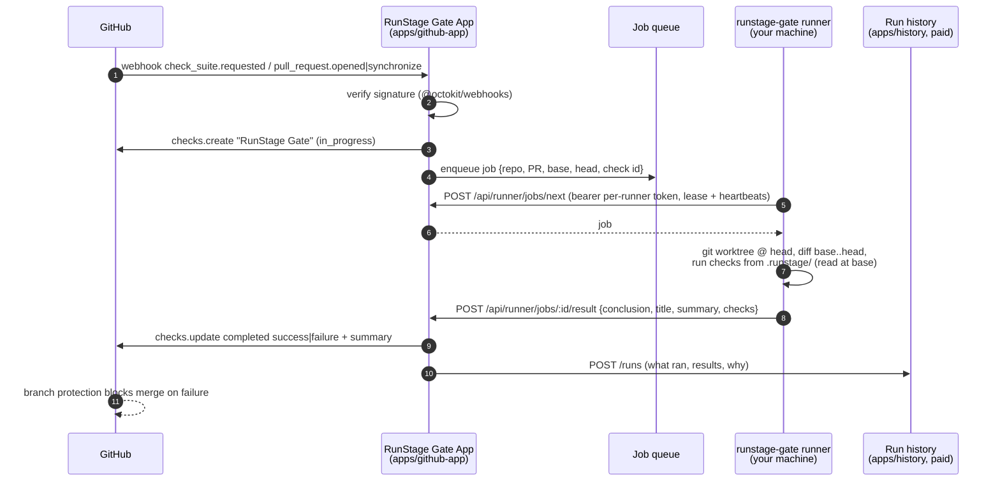
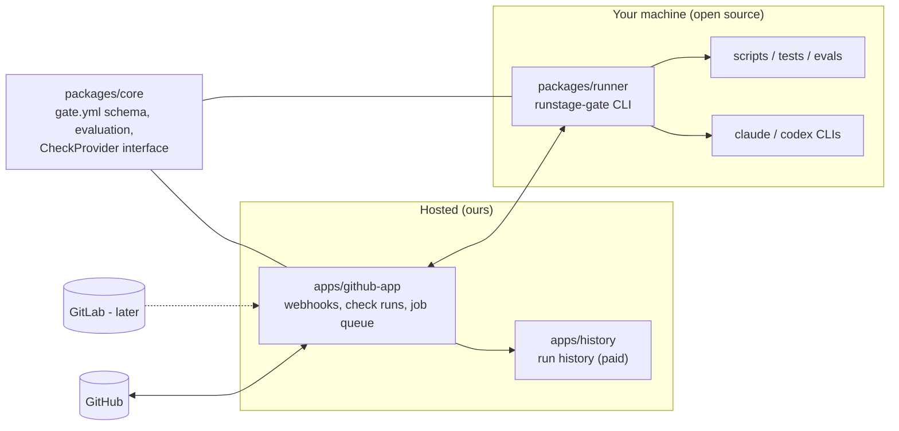

# RunStage Gate

**A merge-blocking quality gate for pull requests that contain AI-generated code.**
Your team's real scripts, tests and evals run on your own machine, and the pull request
can't merge until they pass.

> Status: first slice (v0.1). The full loop works locally and against GitHub through a
> dev App. Nothing is hosted or deployed yet.

## Why

Coding agents open more pull requests than people can review. AI reviewers add comments,
but comments don't stop a merge, and a model can't run your test suite, your migrations
check or the eval that needs your local credentials. RunStage Gate is the **required check**:

- **Real checks, not opinions.** Plain scripts you already have, plus optional AI agent
  tasks that call CLIs you already pay for (Claude Code, Codex).
- **Runs where your stuff lives.** An open-source runner on a developer machine or a spare
  Mac/Linux box. No code or secrets go to our servers.
- **Blocks the merge.** Results land on the PR as the `RunStage Gate` check run, so branch
  protection can require it.
- **Explains itself.** Every verdict says which check failed and why, and the hosted history
  keeps what ran, the results, who approved and why it passed or failed.

## How it works





The code host sits behind a small `CheckProvider` interface (`startCheck`, `completeCheck`)
in `packages/core`. GitHub uses Check Runs. GitLab can be added later with external commit
statuses (all tiers) or Ultimate external status checks, without touching the runner.

## Defining checks: `.runstage/gate.yml`

```yaml
version: 1
agents:
  enabled: false          # agent checks are skipped unless true AND the runner has --allow-agents
checks:
  - name: no-todo-in-diff
    type: script
    run: bash .runstage/checks/no-todo-in-diff.sh
    timeout_seconds: 30
  - name: unit-tests
    type: script
    run: npm test --silent
  - name: ai-review
    type: agent
    agent: claude-code    # claude-code | codex | custom (with command:)
    prompt: Review this diff for security problems and leaked secrets.
    required: false       # agent checks are optional by default
```

- Scripts run with `bash` from the root of a clean worktree of the PR head and get
  `RUNSTAGE_BASE`, `RUNSTAGE_HEAD`, `RUNSTAGE_DIFF_FILE`, `RUNSTAGE_REPO` and
  `RUNSTAGE_CHECK`. Exit 0 passes; the last output line becomes the reason.
- Agent checks get the prompt plus the diff on stdin and must end with `VERDICT: PASS` or
  `VERDICT: FAIL: <reason>`.
- The gate fails if any **required** check fails, errors or times out, or if nothing ran.
- The config is read from the PR's **base** commit, so a PR can't switch off its own gate.
  If the base has no `.runstage/gate.yml`, jobs from the App fail with a clear error (the
  runner never uses its checkout's working tree). A local `runstage-gate run` falls back to
  the working-tree `gate.yml` with a warning, which is handy while drafting a gate.
- The whole `.runstage/` directory (config, check scripts, helpers they source) is also
  taken from the **base** commit: in the check worktree it replaces the PR's copy, while the
  rest of the tree stays at the PR head. A PR that edits, deletes or adds files under
  `.runstage/` is still judged by the base versions. A check whose `.runstage/...` script is
  not on the base errors (it never falls back to the PR's copy), and checks added only in the
  PR's `gate.yml` run after it merges. Keep gate scripts under `.runstage/`: commands outside
  it (e.g. `npm test`) run the PR's own code by design.

See [`examples/gate.yml`](examples/gate.yml) and
[`examples/checks/no-todo-in-diff.sh`](examples/checks/no-todo-in-diff.sh).

## Free vs paid

| Free and open source (Apache-2.0) | Paid (hosted) |
|---|---|
| `runstage-gate` runner CLI, local dry runs | Hosted run history: what ran, results, who approved, why it passed or failed |
| `.runstage/gate.yml` checks, scripts and agent tasks | Search and audit across repos and PRs, retention |
| Self-hosting the App for your own org | Managed GitHub App with no server to run |
| | Team approvals and overrides with an audit trail (planned) |
| | Runner fleet health and alerts (planned) |

## What works now vs what's stubbed

**Works now**

- GitHub App webhook server with signature verification for `check_suite`
  (`requested`, `rerequested`), `check_run` (`rerequested`: the **Re-run** button on the
  `RunStage Gate` check) and `pull_request` (`opened`, `synchronize`, `reopened`). A re-run
  gets a fresh check run and job; it is never de-duplicated against the finished one.
- Creates an in-progress `RunStage Gate` check run, de-duplicates events for the same
  commit, and completes it with `success`/`failure` plus a markdown summary.
- Runner CLI: `run` (local dry run, exit 0/1/2) and `poll` (claim job, run, post result).
  Runs in a temporary git worktree, enforces timeouts, captures output. macOS and Linux.
- Script checks, and agent checks via installed `claude` / `codex` / custom CLIs (gated by
  config and `--allow-agents`).
- Per-runner tokens (stored as SHA-256 hashes, optional repo allowlist, minted with
  `npm run -s runner-token -- mint --id <id>`). Only the runner that claimed a job can
  complete it.
- Durable job queue in a single JSON file (atomic writes) that survives restarts, with claim
  leases plus runner heartbeats (crashed runners' jobs are re-queued) and webhook de-duplication.
- History service with a small web UI at `/`, `POST /runs` and `GET /runs` (JSON; `/api/runs` is an alias), in-memory or a JSON file.
- Tests for config parsing, gate evaluation, the webhook flow (Octokit mocked), the runner
  against temp git repos, and the history stub. End-to-end demo with `npm run demo`.

**Stubbed or not yet built**

- The queue file is meant for one App process. Running several App instances needs a shared
  database (the `JobStore`/`QueueStorage` interfaces are the seam for that).
- Runner tokens are per App, not per GitHub installation or team (no multi-tenant isolation).
- Runs on every PR. Detecting "AI-generated" PRs (labels, bot authors, commit trailers) is
  not built yet.
- `approvedBy` is always null: approve/override flow not built.
- History has no auth on reads, no multi-tenant isolation and no UI.
- `check_run.requested_action` (custom check-run buttons) is not handled.
- No compiled build or npm publish; the runner runs through `tsx`.
- No GitLab provider yet (interface is ready).

## Quick start

Requirements: Node 20+, git, bash.

```bash
npm install
npm run typecheck
npm test
npm run demo          # fake webhook -> queued job -> real runner CLI -> mocked GitHub check result
```

Local dry run of a gate against any repo that has `.runstage/gate.yml`:

```bash
npm run gate -- run --repo /path/to/repo --base origin/main --head HEAD
```

Against real GitHub (dev App + smee.io + branch protection): see
[docs/local-testing.md](docs/local-testing.md).

## Repository layout

```
apps/github-app     webhook server, GitHub check runs, durable job queue, runner tokens, runner API
apps/history        hosted history: web UI at `/`, JSON at `GET /runs`
packages/core       gate.yml schema (zod + yaml), gate evaluation, shared types, CheckProvider
packages/runner     runstage-gate CLI (run, poll)
examples/           gate.yml and the no-todo-in-diff.sh check
scripts/demo.ts     end-to-end local demo
scripts/runner-token.ts  mint / rotate / revoke / list per-runner tokens
docs/               local testing guide, ADRs
```

## License

Apache-2.0. See [LICENSE](LICENSE).
